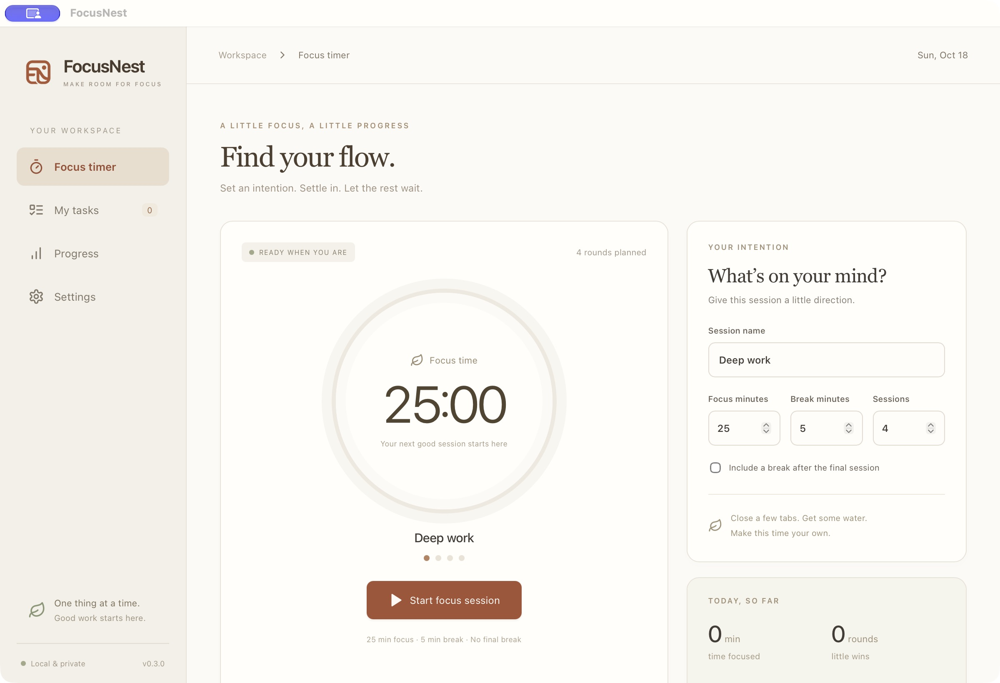

# FocusNest — Rust edition

A standalone migration of FocusNest to **Tauri 2 + Rust + React/TypeScript**, in this folder only. The Python/Flet application remains available in the parent directory.

## App preview



Actual macOS desktop screenshot of FocusNest 0.3.0; no simulated task or progress data.

## Implemented

- Warm cream/terracotta design, persistent sidebar, and the selected FN logo.
- Rust-owned focus/break timer; pause, resume, stop, skip break, next round, optional final break.
- SQLite checkpoints every second while running and on controls/clean exit. Restores paused after relaunch. Sleep/long stalls pause without awarding unobserved focus time.
- Task create/edit/complete/reopen, soft-delete/undo, planned dates, priorities, search and status/priority filters. Today's date group opens by default; other days start collapsed.
- Actual focus intervals, partial sessions, completed rounds/tasks, seven-day local-date totals and the latest 50 runs.
- Persistent defaults, optional session sounds and desktop notifications. Notifications default off until explicitly enabled and permitted.
- Explicit version-1 Python database import using SQLite's backup API, including history, settings and paused active-session recovery. Import is allowed only into an empty destination. The source is opened read-only and is never shared with the Rust app.
- Single-instance desktop behavior: a second launch focuses the existing window.

## Run

Install Node.js 20.19+ (Node 22 LTS recommended), Rust stable, and the native [Tauri prerequisites](https://v2.tauri.app/start/prerequisites/).

```sh
cd focusnest_rust
npm ci
npm run desktop
```

This workspace also has a **project-local Rust toolchain**, ignored by Git. The npm desktop/build commands detect it automatically; other machines use Rust from PATH. To run `cargo` checks directly with that local copy in the current macOS/Linux shell:

```sh
export CARGO_HOME="$PWD/.toolchain/cargo"
export RUSTUP_HOME="$PWD/.toolchain/rustup"
export PATH="$CARGO_HOME/bin:$PATH"
npm run desktop
```

`npm run dev` alone is a read-only browser UI preview: it deliberately does not simulate timers or persist tasks. Actual functionality requires `npm run desktop`.

## Verify

```sh
npm test
npm run build
cargo test --manifest-path src-tauri/Cargo.toml
cargo fmt --manifest-path src-tauri/Cargo.toml --check
```

See [BUILD.md](BUILD.md) for native builds on macOS, Windows and Linux and the migration/release checklist.

For one-command release builds, run `npm run build:mac`, `npm run build:windows` (both x64 and ARM64), or `npm run build:linux` on the corresponding OS after installing its prerequisites. Each script installs locked dependencies and runs tests by default; see [script options and output paths](BUILD.md#one-command-build-scripts).

Tagged releases (`focusnest-vX.Y.Z`) also build and publish installers through GitHub Actions after all platform checks pass. See [automated release instructions](BUILD.md#automated-github-releases). Installers are not certificate-signed/notarized yet; see each release's notes before installing.

## Data safety

The application identifier is `com.focusnest.rust` so it can coexist with the Python edition. It writes `focusnest.sqlite3` inside Tauri's OS-specific application data directory. Settings shows the exact path. `FOCUSNEST_RUST_DATA_DIR` overrides **only the Rust edition** for development/testing. The Python edition's environment variables are intentionally not used.

To migrate: close the Python app, open Settings → Import Python database, confirm the path to `study_timer.sqlite3`, then import a copy. Export/retain a backup of the source before migration. New work in the two editions is independent after import; this is not synchronization. Older schema-zero databases must first be upgraded by the Python app. Newer unknown schemas are rejected without modification.

The schema retains Python table/column names for one-way compatibility. Timer state and history are written in a single SQLite transaction, so a failed write does not advance the in-memory timer. Crash recovery can lose at most the last uncheckpointed tick; a crash is not guaranteed to flush the current second.

## Code map

- `src/` — React screens, styles, typed bridge contracts and display/filter helpers.
- `src-tauri/src/model.rs` — serializable data and independently tested phase transitions.
- `src-tauri/src/runtime.rs` — monotonic timer, recovery, transactions, guarded import.
- `src-tauri/src/store.rs` / `schema.sql` — parameterized SQLite storage and progress reporting.
- `src-tauri/src/lib.rs` — narrow Tauri commands, native events and notifications.
- `src-tauri/capabilities/` — main-window permissions; no shell or general filesystem plugin.
- `public/` / `src-tauri/icons/` — existing FocusNest branding and session audio, copied from the Python project.

## Migration boundaries

This is the first working Rust migration, not a claim of full Python feature parity. Custom audio-file selection/background music, moving overdue tasks in bulk, dedicated past-day drill-down, automatic updates and a tray/minimize workflow are not implemented here yet. The Python version is retained for those features. No real-user database is automatically imported or modified by tests.

Performance improvements must be measured against **release builds**, not the first Rust compilation or Vite development mode. No speedup percentage is claimed yet.
